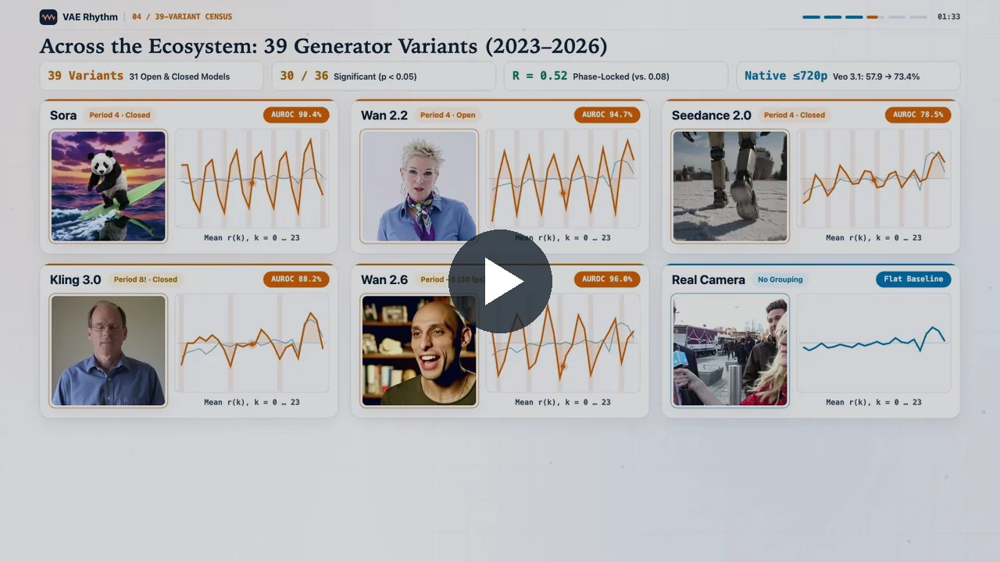
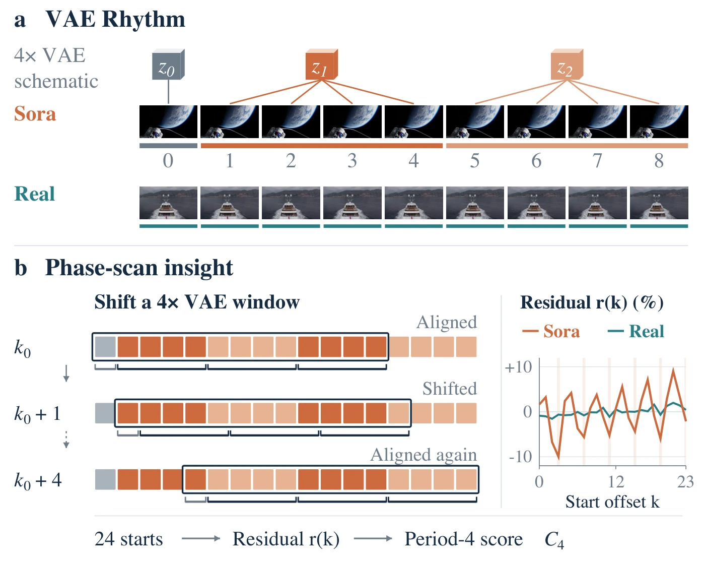
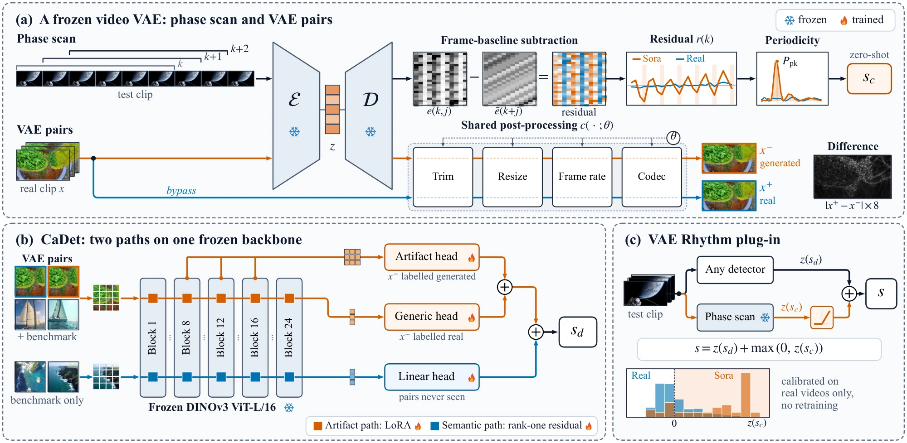
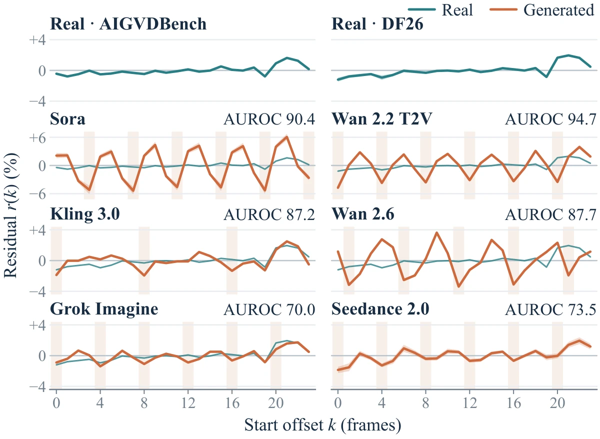
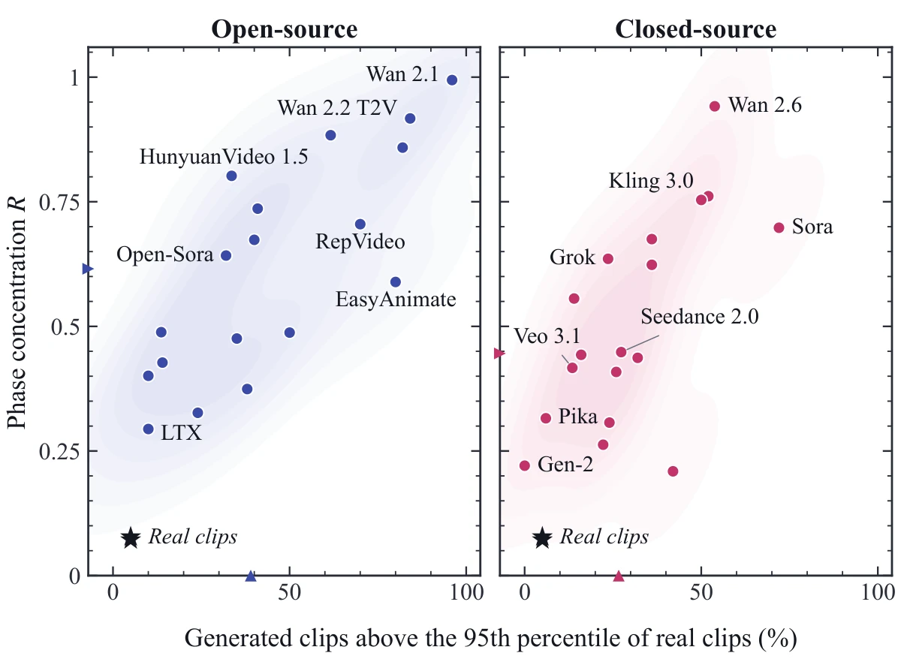
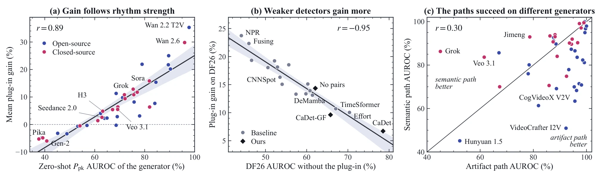

<div align="center">


### Temporal Decoding Traces for AI-Generated Video Detection

Ke Sun · Shuwei Li · Haiyang Mei · Mike Zheng Shou<sup>†</sup>

<sup>†</sup> corresponding author

**Show Lab @ National University of Singapore**

📄 [arXiv Paper](https://arxiv.org/abs/2611.21114) &nbsp;|&nbsp; 🤗 [Daily Paper](https://huggingface.co/papers/2611.21114) &nbsp;|&nbsp; 🧠 [HF Models](https://huggingface.co/Jack97/CaDet) &nbsp;|&nbsp; 🌐 [Project Page](https://showlab.github.io/vae-rhythm/) &nbsp;|&nbsp; 🔍 [Live Demo](https://checkai.space/dashboard?mode=video)

<a href="https://showlab.github.io/vae-rhythm/#video"></a>



<sub>A 4× causal VAE decodes frames in groups. As the VAE window shifts, its groups realign with those of the clip every four starts,<br>so the reconstruction residual of a generated clip oscillates while that of a real clip stays flat.</sub>

</div>

## TL;DR

- **The trace.** Most video generators decode latents with a 3D causal VAE that groups consecutive frames in time. The fidelity of a generated frame therefore rises and falls with its position in a group. We call this periodic trace **VAE Rhythm**. Real videos are captured frame by frame and do not have it.
- **The phase scan.** We reconstruct a clip with an off-the-shelf VAE from successive start offsets and measure the *periodicity* of the reconstruction error, not its level. No training is needed.
- **Three uses.** The rhythm works as a zero-shot score, as a plug-in for any existing detector, and as a data engine that pairs real videos with their VAE reconstructions to train our detector **CaDet**.

## Highlights

- VAE Rhythm appears in most of the **39 variants of 31 generators** we test, including the closed-source Sora, Kling 3.0 and Seedance 2.0.
- **Zero-shot**: without any training, the rhythm score reaches **76.2% AUROC** on DF26 and beats all 15 retrained baselines.
- **Plug-in**: adding the rhythm improves **all 19 tested detectors** on DF26 by **6.7% to 23.7% AUROC**.
- **CaDet** achieves the best AUROC on AIGVDBench, DF26 and three 2026 closed-source models. Its variant **CaDet-GF** never sees a generated video in training and still exceeds 90% on AIGVDBench.

## How it works

<p align="center">
  
</p>

<table>
  <tr><th width="32%" align="left">Part</th><th align="left">What it does</th></tr>
  <tr><td><b>Phase scan</b><br><code>vae-rhythm scan</code></td><td>Zero-shot rhythm statistics (<code>C4</code>, <code>C8</code>, <code>Ppk</code>) and the residual curve of any video</td></tr>
  <tr><td><b>VAE Rhythm plug-in</b><br><code>vae-rhythm plugin</code></td><td>Adds positive rhythm evidence to the scores of any existing detector</td></tr>
  <tr><td><b>VAE-pair engine</b><br><code>vae-rhythm make-pairs</code></td><td>Turns real videos into training pairs that differ only by one VAE round trip</td></tr>
  <tr><td><b>CaDet</b><br><code>vae-rhythm predict</code></td><td>Two paths on one frozen DINOv3 ViT-L/16: an artifact path trained with VAE pairs and a semantic path that never sees them</td></tr>
</table>

## VAE Rhythm across generators

<table>
  <tr>
    <td width="50%" align="center"></td>
    <td width="50%" align="center"></td>
  </tr>
  <tr>
    <td><sub>Mean residual r(k) of generated clips (orange) and real clips (teal). Generated videos oscillate with the group size of their VAE, real videos stay flat.</sub></td>
    <td><sub>Each point is one generator variant. Real clips sit in the lower-left corner, while most open- and closed-source variants have a stronger and more aligned rhythm.</sub></td>
  </tr>
</table>

## Results

AUROC (%), averaged over generators. All detectors are trained on the Open-Sora and real clips of AIGVDBench and tested without retraining. CaDet averages three seeds.

| Method | AIGVDBench open | AIGVDBench closed | 2026 closed | DF26 all | DF26 closed | DF26 2AFC |
|---|:-:|:-:|:-:|:-:|:-:|:-:|
| TimeSformer | 74.3 | 90.7 | 86.4 | 67.0 | 75.8 | 73.4 |
| Effort | 84.3 | 92.5 | 81.6 | 70.4 | 73.4 | 82.6 |
| **CaDet (ours)** | **93.9** | **95.8** | **88.3** | **78.5** | **79.0** | **87.8** |

<p align="center">
  
</p>

<p align="center"><sub>Left: the plug-in gain grows with the rhythm strength of a generator. Middle: weaker detectors gain more on DF26. Right: the two paths of CaDet succeed on different generators.</sub></p>

## Installation

Requirements: Linux (tested; macOS works for the CPU tests), Python ≥ 3.10, **ffmpeg ≥ 4.4 with libx264 and libx265** on `PATH`, and a CUDA GPU for scanning and training. A 24 GB card is enough for 720p scans with one window per VAE call, and `--batch 2` needs about 40 GB.

```bash
git clone https://github.com/showlab/vae-rhythm && cd vae-rhythm
conda create -n vae-rhythm python=3.10 -y && conda activate vae-rhythm
conda install -c conda-forge ffmpeg -y          # or use your system ffmpeg
pip install -e ".[cadet,dev]"                   # core + CaDet + tests
pytest -q                                       # CPU tests, about 5 s
```

The Wan2.1 VAE (about 0.5 GB) is downloaded from Hugging Face on first use. CaDet also needs the DINOv3 ViT-L/16 weights through `timm` (`vit_large_patch16_dinov3.lvd1689m`). Accept the DINOv3 license on Hugging Face and log in with `hf auth login` if the download is refused.

> [!TIP]
> Handing this repository to a coding agent? Point it to [`AGENTS.md`](AGENTS.md), which contains a step-by-step, verifiable setup procedure.

## Quick start

### Scan a video (training-free)

```bash
vae-rhythm scan generated.mp4 real.mp4 --out scan_out/
# generated.mp4: Ppk 0.8321 (period 4.00), C4 0.9425, C8 0.9576, z(Ppk) +3.80, above 100% of reference real videos
# real.mp4: Ppk 0.2007 (period 8.73), C4 0.1552, C8 0.3665, z(Ppk) -0.71, above 27% of reference real videos
```

The example is a Wan 2.2 text-to-video clip and a real clip from DF26, each scanned at 1280 × 720 in about two minutes on a 24 GB GPU. `scan_out/<name>.png` shows the residual curve r(k) and its spectrum, and `scan_out/<name>.json` holds every statistic. In Python:

```python
from vae_rhythm import scan_video
res = scan_video("my_video.mp4")        # Wan2.1 VAE, K=24 offsets, W=13-frame windows, short side capped at 720
print(res.ppk, res.z_ppk, res.stats["C4"], res.segments[0].curve)
```

<details>
<summary><b>How to read the numbers</b></summary>

* `Ppk` is the period-agnostic rhythm score, the largest normalised periodogram bin for periods of 2.5 to 9 frames. `C4` and `C8` are the shares of residual variance in the period-4 and period-8 harmonic combs.
* `z(Ppk)` standardises `Ppk` against 299 real validation videos scanned with the same protocol (bundled in `vae_rhythm/calibration/`). About 5% of real clips exceed z ≈ 2.35.
* A weak rhythm is not evidence that a video is real. Low motion, frame-rate conversion, upscaling and heavy re-encoding all weaken it. The scan should also run near the generation scale, so keep the default 720p cap, or use 480p for typical 2024–2026 generators.
* `--segments 3` also scans the middle and the end of longer videos and reports the median.

</details>

### Add the rhythm to your own detector

Given per-video scores of any detector and the `Ppk` of the same videos, the plug-in computes `s = z(s_d) + max(0, z(Ppk))`, where `z(s_d)` standardises the detector score on real calibration videos:

```bash
vae-rhythm scan-manifest test.csv --out ppk.csv --npz-dir npz/                 # Ppk of the test videos
vae-rhythm plugin --scores det_test.csv --det-real det_val_reals.csv --ppk ppk.csv \
                  --manifest test.csv --out fused.csv                          # prints AUROC before / after
```

All CSVs use a `video_id` column. Manifests also have `path`, `label` (0 real, 1 generated) and `subset` (generator name). See [`docs/data.md`](docs/data.md).

### Run CaDet

The CaDet weights (three seeds, about 17 MB each) are on [Hugging Face](https://huggingface.co/Jack97/CaDet):

```bash
hf download Jack97/CaDet --local-dir checkpoints/cadet       # seed0/ seed1/ seed2/
vae-rhythm predict my_video.mp4 --weights checkpoints/cadet/seed0
# my_video.mp4: CaDet score ... (semantic z ..., artifact z ...)
```

Scores are sums of z-scores relative to real validation videos (0 is a typical real video, and higher means more likely generated). They are not probabilities. For a binary decision, pick a threshold on real videos of your own domain, for example with `vae_rhythm.plugin.threshold_at_fpr`.

## Reproducing the paper

[`docs/reproduce.md`](docs/reproduce.md) gives the commands for every stage:

1. **Data**: AIGVDBench (train / val / test), DF26 and the 2026 closed-source sets, with manifests.
2. **Census and zero-shot** (Table 1): `scan-manifest` at 480p and 720p, then `evaluate`.
3. **Plug-in** (Table 3): native-resolution scans capped at 720p, calibrated on AIGVDBench validation reals.
4. **VAE pairs** (Section 4.1): `scripts/make_paper_pairs.sh` (two engine passes, 9:1 train / val split).
5. **CaDet** (Table 2): `scripts/train_cadet.sh` trains both paths for one seed, calibrates and evaluates.

<details>
<summary><b>Repository layout</b></summary>

```
vae_rhythm/
  stats.py          phase-scan statistics: residual curve r(k), C4 / C8 / Ppk, phase, spectrum (NumPy only)
  vaes.py           VAE wrappers (Wan2.1 / Wan2.2 / HunyuanVideo / CogVideoX / LTX-Video) for round trips
  video.py          ffmpeg / PyAV I/O and the scan protocol (cap, x264 CRF 23, GOP 32)
  scan.py           phase scan of frames, videos and manifests; plots; z(Ppk) calibration
  plugin.py         the plug-in: hybrid standardisation, positive-part fusion, operating points
  metrics.py        AUROC with ties, per-generator tables, paired 2AFC
  engine/           VAE-pair engine (chain.py: post-processing chain, pairs.py: driver)
  cadet/            CaDet: frame cache, augmentations, models, training, inference / export
  calibration/      bundled real-video calibration of Ppk (Wan2.1, K24/W13, 720p cap)
  cli.py            `vae-rhythm` command line
scripts/            paper pipelines (pairs, CaDet training)
docs/               data preparation, protocol details, reproduction guide
tests/              CPU unit tests
```

</details>

## Citation

```bibtex
@article{sun2026vaerhythm,
  title   = {VAE Rhythm: Temporal Decoding Traces for AI-Generated Video Detection},
  author  = {Sun, Ke and Li, Shuwei and Mei, Haiyang and Shou, Mike Zheng},
  journal = {arXiv preprint arXiv:2611.21114},
  year    = {2026}
}
```

## License and acknowledgements

The code is released under the MIT license (see [`LICENSE`](LICENSE)). The CaDet weights are adapters for DINOv3 ViT-L/16 and are subject to the [DINOv3 License](https://ai.meta.com/resources/models-and-libraries/dinov3-license/). The phase scan uses the Wan2.1 VAE (Apache-2.0). The semantic path follows the training recipe of [Effort](https://github.com/YZY-stack/Effort-AIGI-Detection). We evaluate on AIGVDBench and DF26.
